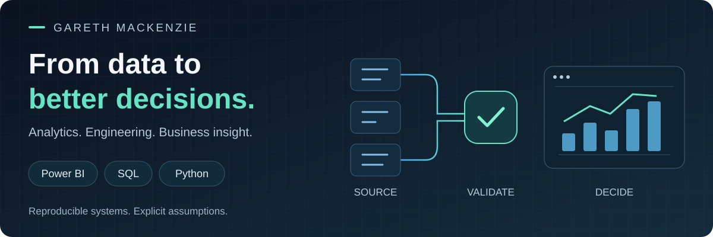

  

# Gareth Mackenzie

**Analytics Engineering · Business Intelligence · Operational Decision Support**

I build reproducible analytical systems that make data quality, assumptions and release decisions explicit.

Johannesburg, South Africa · [LinkedIn](https://www.linkedin.com/in/gareth-andrew-mackenzie-50407b52/)

## Flagship projects

### 01 — [Operations Decision Lab](https://github.com/GarethMackenzie/operations-decision-lab)

**Question:** Can a small team's picking and packing allocation meet declared demand, budget and service constraints?

**Decision:** Compare supported allocations, including an explicit **NO CONFIRMED FEASIBLE OPTION** outcome.

**Evidence:** reproducible simulation reports, separate selection and evaluation, sensitivity analysis and an independent scheduling reference in tests.

**Boundary:** synthetic local research prototype; external staffing impact has not been validated.

[Repository](https://github.com/GarethMackenzie/operations-decision-lab) · [Architecture](https://github.com/GarethMackenzie/operations-decision-lab/blob/main/docs/ARCHITECTURE.md) · [Evaluation protocol](https://github.com/GarethMackenzie/operations-decision-lab/blob/main/CASE_STUDY.md)

### 02 — [Analytics Release Gate](https://github.com/GarethMackenzie/analytics-release-gate)

Open-source Python CLI for auditing analytics and Power BI repositories before release.

`Python · CLI · PBIP/PBIR · TMDL · DAX checks · CI/CD`

**Evidence:** 15 documented release rules spanning repository hygiene, Power BI project integrity, DAX heuristics, security signals, documentation and reproducibility, with console and JSON reporting.

[Repository](https://github.com/GarethMackenzie/analytics-release-gate) · [PyPI](https://pypi.org/project/analytics-release-gate/) · [v0.1.0 release](https://github.com/GarethMackenzie/analytics-release-gate/releases/tag/v0.1.0)

### 03 — [Eskom Strategic Intelligence](https://github.com/GarethMackenzie/eskom-strategic-intelligence)

Executive public-data analytics system covering municipal debt, electricity demand, tariffs, financial performance and physical-security risk.

`Power BI · PBIP/PBIR · TMDL · DAX · Python · SQLite`

**Evidence:** 40 governed source records · 17 release-blocking data-quality checks · 32 automated tests · 34 explicit DAX measures · 5 report pages · deterministic rebuild validation.

[Repository](https://github.com/GarethMackenzie/eskom-strategic-intelligence) · [Actions](https://github.com/GarethMackenzie/eskom-strategic-intelligence/actions)

### 04 — [Insurance Claims Intelligence](https://github.com/GarethMackenzie/insurance-claims-intelligence-powerbi)

Source-controlled Power BI decision support for synthetic claims performance, financial exposure, service, operations and risk-based human review.

`Power BI · PBIP/PBIR · TMDL · DAX · Power Query · Python · SQL`

**Evidence:** deterministic data pipeline · governed star schema · 79 explicit DAX measures · 8 report pages · automated QA · hosted CI.

[Repository](https://github.com/GarethMackenzie/insurance-claims-intelligence-powerbi) · [Actions](https://github.com/GarethMackenzie/insurance-claims-intelligence-powerbi/actions)

> Portfolio projects use synthetic or public data and are designed to demonstrate engineering and analytical methods. They do not contain customer, policyholder or employer-confidential data.

## Additional systems

- **[Banking Process Excellence](https://github.com/GarethMackenzie/banking-process-excellence-lean-six-sigma)** — Lean Six Sigma DMAIC analytics for a fictional retail-banking onboarding and KYC process using synthetic data. `Python · DMAIC · SPC · MSA · DOE · Regression · CI`
- **[Motor Claims Risk Triage](https://github.com/GarethMackenzie/motor-claims-triage)** — capacity-constrained machine-learning review prioritisation using synthetic claims data and leakage-safe evaluation. `Python · scikit-learn · XGBoost · Decision Science · CI`

## Engineering capability

- **Analytics Engineering** — reproducible pipelines, dimensional modelling, governed transformations, data-quality controls and CI.
- **Business Intelligence** — Power BI, semantic modelling, DAX, Power Query, PBIP/PBIR and executive decision support.
- **Data & Automation** — Python, SQL, deterministic workflows, validation and release automation.
- **Decision Science** — statistical analysis, hypothesis testing, ranking metrics, human-in-the-loop workflows and responsible model governance.
- **Process Excellence** — Lean Six Sigma, SPC, MSA, DOE, root-cause analysis and operational improvement.

## Technical stack

**Core:** Power BI · SQL · Python · DAX · Power Query  
**Data & modelling:** SQLite · dimensional modelling · TMDL · PBIP/PBIR  
**Engineering:** Git · GitHub Actions · CI/CD · automated QA · reproducible builds  
**Analytics:** statistical testing · predictive modelling · process analysis · decision support

## Professional context

My background combines financial-services and insurance operations with analytics engineering, process improvement, internal controls and risk-aware decision support. I focus on translating operational problems into measurable analytical systems that can be reviewed by both technical and business stakeholders.

For full career chronology, see [LinkedIn](https://www.linkedin.com/in/gareth-andrew-mackenzie-50407b52/).

## Education & selected credentials

- **University of South Africa (UNISA)** — Bachelor of Business Administration
- Microsoft Certified: Power BI Data Analyst Associate
- Microsoft Certified: Azure Data Scientist Associate
- Oracle Cloud Infrastructure Data Science Professional
- Oracle Analytics Cloud 2025 Professional
- Lean Six Sigma Black Belt

## Writing and publishing

[Author website](https://garethmackenzie.github.io/) — books and essays, separate from the engineering projects above.

## Connect

[LinkedIn](https://www.linkedin.com/in/gareth-andrew-mackenzie-50407b52/) · [GitHub](https://github.com/GarethMackenzie)
